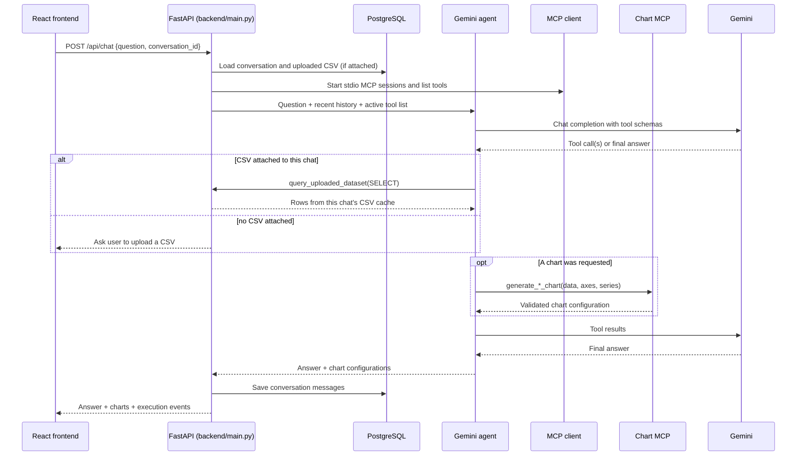

# Data Detective backend: code walkthrough

This guide explains the backend as it exists in this project. It is intended for a code walkthrough, technical interview, or presentation. The backend is a FastAPI service, one AutoGen AgentChat assistant using Gemini, a chart MCP server, PostgreSQL persistence, and a per-chat CSV analysis path.

## 1. What the backend does

The backend accepts a question from the React client, retrieves that chat's history and optional uploaded CSV, asks Gemini how to investigate it, executes the requested tools, and returns a text answer plus optional chart data and an execution trace.

Each investigation requires an uploaded CSV. The analytics agent has no access to seeded or shared business data.

| Chat state | Data used for analysis | Persistence |
| --- | --- | --- |
| No CSV attached | No analytics query runs; the API asks the user to upload a CSV | Conversation history persists in PostgreSQL |
| CSV attached | Only that chat's CSV, queried through a chat-specific SQLite in-memory cache; the original CSV is stored in PostgreSQL | CSV and conversation history persist in PostgreSQL |

The agent receives only the active chat's CSV query tool and chart tools. PostgreSQL stores accounts, sessions, chat history, execution traces, and CSV bytes, but is not available to the analytics agent as a query source.

## 2. Request architecture



The tool call exchange can repeat. The orchestrator allows up to 12 model/tool rounds in one question.

## 3. Backend file map

| File | Responsibility |
| --- | --- |
| `backend/main.py` | FastAPI routes, chat state, persistence calls, upload/download metadata, error-to-HTTP mapping |
| `backend/agent/orchestrator.py` | AutoGen `AssistantAgent`, Gemini model client, JSON-schema-to-function-tool adaptation, and tool callbacks |
| `backend/agent/mcp_client.py` | Starts MCP subprocesses, initializes MCP sessions, discovers and routes tools |
| `backend/datasets.py` | Parses and validates CSV uploads, creates an isolated in-memory SQLite cache, runs read-only dataset queries |
| `backend/mcp_servers/chart_server.py` | MCP interface for bar, line, and pie chart configuration tools |
| `backend/agent/chart_guard.py` | Checks chart rows, columns, numeric series, and size limits |
| `db/init_storage.py` | Creates PostgreSQL chat/upload tables and the limited app role; loads no analytics dataset |
| `docker-compose.yml` | Connects PostgreSQL storage, storage initializer, API, and frontend containers |

## 4. API and application state

### Startup

`backend/main.py` creates the FastAPI application, configures CORS, and initializes the Gemini `Agent` in `startup()` when `GEMINI_API_KEY` is present. It does not keep conversations, uploaded datasets, or execution traces in process-level dictionaries. Authenticated requests load durable state from PostgreSQL; CSV analysis builds and closes a temporary SQLite database per request. This makes state available across Vercel function instances.

### Routes

| Route | Purpose |
| --- | --- |
| `GET /api/health` | Reports API status and whether the Gemini key enabled the agent |
| `GET /api/conversations` | Lists the signed-in user's conversations directly from PostgreSQL |
| `GET /api/conversations/{id}` | Loads a conversation from PostgreSQL after checking ownership |
| `POST /api/conversations/{id}/dataset` | Validates, stores, and attaches a CSV to a conversation ID |
| `GET /api/conversations/{id}/dataset` | Loads dataset metadata from PostgreSQL after checking ownership |
| `DELETE /api/conversations/{id}/dataset` | Removes the uploaded dataset record after checking ownership |
| `POST /api/chat` | Loads chat state from PostgreSQL, runs one investigation, and persists the conversation and trace |
| `GET /api/executions/{id}` | Returns a persisted execution trace after checking ownership |

`ChatRequest` requires a question of 1–4,000 characters and optionally accepts a conversation ID. The ID ties messages and the uploaded CSV together.

Example chat request:

```http
POST /api/chat
Content-Type: application/json

{
  "question": "Show revenue by region",
  "conversation_id": "<conversation UUID>"
}
```

Example dataset upload (the frontend creates the UUID before uploading):

```sh
curl -F 'file=@sales.csv' \
  http://localhost:8000/api/conversations/<conversation-uuid>/dataset
```

The upload response includes the filename, normalized column list, row count, and conversation ID. The chat response includes `answer`, `charts`, `query_results`, `events`, `execution_id`, and `conversation_id`. The last uploaded-CSV query is returned as a 100-row preview for the data table and SQL tabs. The chart objects are data/configuration payloads, not image files.

### Chat lifecycle

The `chat()` route:

1. Checks that the Gemini agent is enabled.
2. Finds or creates the conversation and a new execution ID.
3. Appends the user question and prepares recent conversational history.
4. Calls `load_dataset(cid)`. If no CSV exists, the API asks for an upload without invoking the analytics agent.
5. For a chat with a CSV, opens the chart MCP connection and calls `agent.run(...)` with that chat's dataset.
6. Appends the assistant answer and any chart configuration, then saves the conversation to PostgreSQL.
7. Returns the answer, charts, execution ID, and events to the frontend.

The API maps Gemini timeouts to HTTP 504, quota/rate errors to 429, overload responses to 503, and other Gemini errors to 502. Other unexpected failures are logged and returned as a generic analysis error.

## 5. AutoGen agent and Gemini tool calling

`backend/agent/orchestrator.py` creates one AutoGen AgentChat `AssistantAgent` for each incoming question. AutoGen manages the model/tool loop and final reflection. Its `OpenAIChatCompletionClient` uses Google's OpenAI-compatible Gemini endpoint:

- Base URL: `https://generativelanguage.googleapis.com/v1beta/openai/`
- API key: `GEMINI_API_KEY`
- Model: `GEMINI_MODEL`, defaulting in code to `gemini-3.8-flash`
- Request timeout: 45 seconds per model request
- SDK automatic retries: disabled (`max_retries=0`)
- Parallel tool calls: disabled so calls remain ordered and a chat's SQLite connection is not used concurrently.

Gemini is configured as an OpenAI-compatible, non-OpenAI model. `model_info` explicitly declares that it supports function calling. The AutoGen documentation supports custom OpenAI-compatible endpoints but cautions that providers are not guaranteed to work identically, so the Gemini integration should be rechecked when either dependency changes.

Before the assistant runs, `MCPConnections.tools()` discovers live MCP tool names and JSON Schemas. `_make_autogen_tool()` maps each schema's common types to a Python signature and wraps the function as an AutoGen `FunctionTool`. The wrapper routes calls back to `MCPConnections.call(...)`; for uploaded CSVs, the dataset query wrapper calls that chat's SQLite cache. This leaves the project's MCP servers intact while AutoGen handles orchestration.

Each tool callback logs a running event, executes the tool, captures any chart configuration, logs completion or failure, and returns JSON text to AutoGen. The assistant allows up to 12 tool iterations and reflects on tool results to generate the final answer. Tool output is capped at 50,000 serialized characters. The Gemini API key is never passed to an MCP process.

### Closed-world instruction

The system prompt tells Gemini to use only results from this chat's uploaded dataset and verified context. The backend enforces this by not calling Gemini when there is no upload and by exposing no PostgreSQL analytics tools.

This instruction guides the model but is not itself a security boundary. The stronger data boundary is which tools the backend exposes for the current chat.

### Why AutoGen and MCP are both present

AutoGen is the agent orchestration framework; MCP is the protocol used by the existing database and chart tools. AutoGen does not replace those MCP servers: dynamically discovered MCP schemas are adapted to AutoGen function tools, and calls still execute through the existing MCP client.

## 6. MCP connections and tool discovery

`backend/agent/mcp_client.py` starts only `chart_server.py` as a child process over standard input/output (stdio). It initializes the MCP session, requests the live chart-tool list, and routes chart calls to that server. `AsyncExitStack` closes the subprocess/session when the investigation finishes, including partial-startup failures. `Agent.run()` adds one dynamic `query_uploaded_dataset` tool whose description contains the current CSV's sanitized column names. No PostgreSQL query server is started.

## 7. PostgreSQL persistence boundary

PostgreSQL is used by FastAPI to persist users, sessions, conversations, execution events, and uploaded CSV bytes. The limited `detective_app` role can read/write only the application tables. No database MCP server is started, no seeded analytics schema is created on a fresh install, and the agent receives no PostgreSQL query credentials or query tools. Each analysis rebuilds a request-local SQLite database from only the current conversation's CSV.

## 8. User-uploaded CSV path and chat isolation

### Upload validation

`POST /api/conversations/{id}/dataset` accepts multipart file uploads and currently supports `.csv` only. `UploadedDataset.from_csv()`:

- Rejects content over `MAX_UPLOAD_BYTES` (5 MB locally; set lower for serverless request-body limits).
- Decodes UTF-8 with an optional BOM.
- Requires a header and allows no more than 100 columns.
- Allows no more than 20,000 data rows.
- Converts headers into safe SQLite identifiers and makes duplicate names unique.
- Loads all field values as SQLite `TEXT` columns.

The original byte content, filename, sanitized column list, and row count are saved in PostgreSQL's `uploaded_datasets` table, keyed by the conversation UUID. The same conversation row is created if this is the first interaction.

### Durable storage plus query cache

The uploaded CSV is durable in PostgreSQL. For analysis, `load_dataset()` reads the stored CSV bytes and `UploadedDataset.from_csv()` builds an isolated SQLite `:memory:` table named `uploaded_data`. This database is created for the analysis request and closed when the request completes.

This design gives the project a durable source file and simple SQL aggregation for the agent, while maintaining a distinct in-memory query database per analysis. It is rebuilt from PostgreSQL for each analysis. Different conversation IDs cannot read each other's CSV content.

### Uploaded-data query guard

The dynamically added `query_uploaded_dataset` tool accepts a SQL string. `UploadedDataset.query()` requires a SELECT/CTE prefix, rejects embedded multiple statements, and installs a SQLite authorizer for query execution. The authorizer permits SELECT/function actions and reads from `uploaded_data`; other SQLite actions and reads from other tables are denied. It returns up to 500 rows and a truncation flag.

CSV columns remain text. Numeric aggregation usually relies on SQLite's numeric coercion or explicit `CAST`, so ambiguous numeric formats (for example, currency symbols or locale-specific decimal separators) can produce incorrect results and may need preprocessing in a future version.

### Isolation behavior

The chat ID is the key used for both saved CSV metadata/content and conversation messages. When the agent sees a CSV for that ID, it receives only the CSV query tool and chart tools. A chat without an uploaded file cannot run analytics and receives an upload prompt. Replacing a dataset in an active chat with existing messages causes the frontend to start a new chat ID so old analysis context does not get mixed with the new file.

## 9. Chart generation

The chart MCP server does not render an image. It validates and returns a Recharts-ready JSON configuration. The React frontend renders that config. Analysis cards separate visualization, sortable/filterable query preview, and generated SQL into tabs. The `⌘K` command palette searches uploaded filenames, recent questions, and investigations.

The agent first queries and verifies numeric result rows, then calls `generate_bar_chart`, `generate_line_chart`, or `generate_pie_chart`. `chart_guard.py` checks that:

- Data is non-empty and has at most 500 rows.
- The requested x-axis and value series exist in each row.
- There are at most eight value series.
- Every value is numeric and not a boolean.

For multi-series charts, the agent should return one row per x-axis category/time point and name each series as a separate numeric column. This avoids charting just one region/category when the query produced several.

## 10. Persistence and serverless requests

| State | Storage | Survives an API instance restart? |
| --- | --- | --- |
| Users and password hashes | PostgreSQL `users` | Yes |
| Session token hashes | PostgreSQL `sessions` | Yes |
| Uploaded CSV original bytes and metadata | PostgreSQL `uploaded_datasets` | Yes |
| Conversation title and messages | PostgreSQL `conversations` JSONB | Yes |
| Tool execution events and timing | PostgreSQL `executions` JSONB | Yes |
| SQLite query database for an analysis | Request-local memory; rebuilt from PostgreSQL CSV bytes | No, and it is safe to rebuild |

The API reads each conversation and its execution traces from PostgreSQL instead of relying on a process-level dictionary. This allows requests to reach a fresh Vercel function instance without losing chat history or execution records. The uploaded CSV is loaded into a separate in-memory SQLite database for each analysis and closed after the request.

The schema initializer can use `DATABASE_ADMIN_URL` to connect to a managed PostgreSQL database. It creates the restricted `detective_app` role using `APP_PASSWORD`, creates or updates the application tables, and grants that role access. Keep the provider admin URL out of Vercel; the API only needs `APP_DATABASE_URL` for the `detective_app` role.

The Docker command `docker compose down -v` removes the local PostgreSQL named volume and therefore deletes local accounts, sessions, CSVs, chats, and traces. A normal API restart does not remove persistent PostgreSQL data.

## 11. Errors and observability

The API logs with Python's standard logging configuration. Gemini errors are separated into timeout, status, and general exception paths. The frontend receives structured execution events (`running`, `completed`, or `failed`) and can expand them to see tool names, MCP server names, arguments, summaries, and tool durations.

Execution records are persisted in PostgreSQL and fetched by owner and execution ID, so the frontend can restore prior traces after an API instance restart.

## 12. Main limitations and extension points

1. **CSV only.** Excel and Parquet files are not accepted.
2. **Vercel function limits.** Chat and Gemini work happens synchronously in one request, so a slow model call can exceed the plan's maximum request duration.
3. **MCP subprocess runtime.** The chart MCP server starts through a stdio subprocess. Vercel preview deployment must confirm subprocess launch and file inclusion work in its Python runtime.
4. **CSV values are all text.** Dates, currency, null conventions, and numeric types are not inferred or validated.
5. **SQL validation is intentionally lightweight.** Production deployments should retain the read-only SQL guard, resource limits, and per-user authorization.
6. **Persistence role password defaults are for local development.** Set a strong `APP_PASSWORD` outside local development.
7. **AutoGen maintenance status.** AutoGen is pinned to version 0.7.5. Microsoft's current AutoGen documentation marks the project archived and unmaintained; this integration follows the requested framework, but a maintained framework should be considered before a production deployment.

## 13. A concise walkthrough to present

> “The React app sends a question and conversation ID to FastAPI. FastAPI loads that user's chat history and its uploaded CSV from PostgreSQL. If there is no upload, the API asks for one and does not call the model. Otherwise, the CSV is loaded into an isolated, read-only SQLite database for that request. The Gemini agent receives a query tool for that one chat's CSV and chart tools through MCP. PostgreSQL stores users, sessions, chat history, execution traces, and the original CSV, but is not available to the analytics agent as a query source. The API saves the answer and returns chart configurations and execution events to the frontend.”

### Questions you may be asked

**Why MCP?** It standardizes tool discovery and invocation. The agent does not hard-code SQL/chart server implementations; it lists tools and calls them through MCP sessions.

**Why is PostgreSQL still used?** It persistently stores users, sessions, conversations, execution traces, and uploaded CSV files. It does not supply analytics data to the model; each uploaded CSV is queried in a separate per-chat SQLite cache.

**Why keep uploaded CSV bytes in PostgreSQL if a SQLite cache is used?** PostgreSQL is the durable source that allows a chat to continue after API restart. SQLite is only the temporary query engine/cache rebuilt from that source.

**How do you stop the model from modifying data?** The CSV query path uses a SQLite authorizer that permits reads only from the current chat's `uploaded_data` table.

**How are uploads isolated?** Dataset persistence is keyed by conversation UUID, and each analysis constructs a SQLite database from only that conversation's CSV. The agent receives only that chat's dataset query tool; there is no shared analytics database tool.

**What is the difference between a chart and chart data?** The chart MCP server validates a configuration; the browser's Recharts components draw it.
